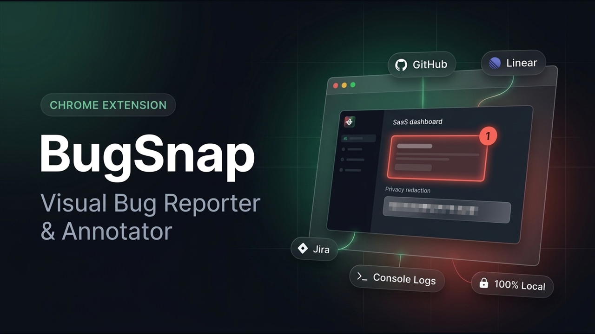

  
  <h1>BugSnap — Visual Bug Reporter &amp; Screenshot Annotator</h1>
  
<strong>100% 本地端視覺化 Bug 回報工具：截圖標註、敏感資料馬賽克打碼、自動採集瀏覽器環境與 Console 錯誤 → 一鍵輸出 GitHub / Linear / Jira / Notion 報告</strong>

  
Capture screenshots with red boxes, arrows, true mosaic redaction, auto browser/console logs &amp; dev-ready Markdown bug reports — 100% local, zero cloud uploads, no monthly subscription.

  

    <a href="https://eggcellent20.gumroad.com/l/hcneur"><strong>Get BugSnap Pro ($14 Lifetime)</strong></a> ·
    <a href="https://egg9372000.github.io/bugsnap/"><strong>Website</strong></a> ·
    <a href="https://egg9372000.github.io/bugsnap/privacy.html"><strong>Privacy Policy</strong></a>
  

  

---

> 🌐 **Language / 語言切換**：[繁體中文](#繁體中文介紹) | [English](#english-overview)

---

## 繁體中文介紹

### 為什麼做 BugSnap？

市面上的視覺化 Bug 回報工具（如 Marker.io、Userback、Jam.dev 進階版）要嘛每個月收費 **\$39–\$199/月**，要嘛強制把客戶後台截圖與 Console 錯誤上傳到第三方雲端伺服器——對接案團隊、企業內網 QA 與重視資安的開發者來說既昂貴又有外洩風險。

**BugSnap** 提供完全相反的解法：**100% 瀏覽器本地端執行、零雲端上傳、\$14 一次性買斷**：

- **一鍵截圖進入標註工作室**：直接擷取當前視窗高清 PNG 並自動記錄完整 URL、視窗解析度、DPR、螢幕尺寸、瀏覽器與時間戳記。
- **真正不可逆的馬賽克打碼（Blur Redact）**：分享給客戶或貼到 Issue 前，直接在畫布上框選打碼遮蓋 Email、API Key、金額等敏感資訊。
- **紅框、箭頭、步驟編號（①②③）與文字批註**：10 秒標出 Bug 位置，支援一鍵複製圖片貼進 Slack / Teams / GitHub，或下載 PNG。
- **即時 Console Error 錯誤側錄（Pro）**：不需開 F12 手動截圖，在該分頁點一下 Attach 就能自動紀錄 `console.error`、`console.warn` 與未捕捉例外（Uncaught Exceptions）。
- **一鍵輸出工程師專用 Issue Markdown（Pro）**：內建 **GitHub / Notion**、**Linear**、**Jira Wiki** 三大格式模板＋診斷 JSON 匯出，貼上就能直接開票！

### 免費版 vs. Pro 買斷版比較

| 功能 | 免費版（Free） | Pro 終身買斷版（$14 一次性，無月費） |
|---|:---:|:---:|
| 一鍵截圖、紅框、箭頭、**敏感資料馬賽克打碼** | ✅ | ✅ |
| 自動採集 URL / 解析度 / 瀏覽器環境資訊 | ✅ | ✅ |
| 複製標註後圖片至剪貼簿 / 下載 PNG | ✅ | ✅ |
| **即時 Console Error / Exception 側錄** | — | ✅ |
| **步驟編號圓點標記（①②③）與文字批註** | — | ✅ |
| **一鍵複製 GitHub / Linear / Jira / Notion Markdown 報告** | — | ✅ |
| **匯出診斷 JSON & 擴充本機歷史草稿庫** | 前 3 筆 | ✅ **最多 25 筆＋JSON** |
| 100% 本地運算、零雲端上傳、免註冊帳號 | ✅ | ✅ |

### 如何啟用 Pro 授權

1. 前往 [Gumroad 官方購買頁 ($14 USD 終身買斷)](https://eggcellent20.gumroad.com/l/hcneur) 取得專屬授權碼。
2. 點擊工具列 **BugSnap** 圖示 → 右上角 **`FREE`** 徽章 → 貼上授權碼 → **`Activate`** 立即永久解鎖。

---

## English Overview

### Why BugSnap?

Cloud QA bug-reporting tools (Marker.io, Jam.dev Pro, Userback) charge **\$39–\$199/month** and force you to upload private staging screenshots and console logs to third-party servers.

**BugSnap** is a **100% local, zero-cloud, \$14 one-time** Chrome & Edge extension built for QA engineers, PMs, agencies, and developers:

- **Instant Capture & Annotation Studio**: Highlight boxes, crisp arrows, and **true pixelation blur redaction** to mask PII/secrets before sharing.
- **Auto Environment Metadata**: Captures URL, viewport, DPR, screen resolution, locale, and timestamp automatically.
- **On-Demand Live Console Error Recorder (Pro)**: Records `console.error`, `console.warn`, and uncaught exceptions on the active tab without opening DevTools.
- **1-Click Dev-Ready Issue Templates (Pro)**: Copy formatted **GitHub / Notion**, **Linear**, or **Jira** bug reports with steps to reproduce, environment tables, and console logs, or export diagnostic JSON.
- **100% Local & Private**: Zero cloud uploads, zero telemetry, zero recurring fees. Read our [Privacy Policy](https://egg9372000.github.io/bugsnap/privacy.html).
